# Architecture, DSP & Mathematical Recipes (`terminal-trip`)

This document details the software architecture, digital signal processing (DSP) pipeline, vectorized NumPy effect mathematics, 256-color palette cycling engine, and half-block ANSI terminal renderer that power **terminal-trip**.

---

## 1. System Architecture & 60 FPS Pipeline

To maintain a locked 60 FPS without audio dropouts or terminal flicker, audio capture runs asynchronously into a thread-safe ring buffer while the main thread executes a fixed-timestep NumPy rendering pipeline and flushes a single pre-assembled ANSI string per frame.

```mermaid
flowchart LR
    subgraph AudioThread["Audio Capture / Synthesis"]
        A1["WASAPI Loopback (Spotify/System)"] --> RB["Sample Ring Buffer"]
        A2["Local Audio File (.wav / .mp3 / .flac)"] --> RB
        A3["Procedural 125 BPM Acid Synth"] --> RB
    end

    subgraph DSP["DSP & Feature Extractor (audio.py)"]
        RB --> FFT["2048-Sample Hann Window + rFFT"]
        FFT --> Bands["48 Log Spectrum Bars + 3 Macro Bands"]
        Bands --> AGC["4s Half-Life Auto-Gain Control (AGC)"]
        AGC --> Beat["Asymmetric Envelope & Beat Transient Detector"]
    end

    subgraph Engine["Retro Indexed Software Renderer (effects/)"]
        Beat --> Preset["Active Visual Preset (1-8, 2x2 SSAA Canvas)"]
        FBPrev["Previous Framebuffer (2H x 2W float32)"] -->|"Bilinear Warp / Isotropic Blur"| Preset
        Preset --> SSAA["2x2 Box-Filter Downsampler (H x W)"]
        Preset -->|"Feedback State"| FBPrev
        SSAA --> FB["Indexed Framebuffer (H x W uint8, 0..255)"]
        Beat -->|"Phase Shift + Beat Jump"| LUT["256-Color RGB Palette LUT (256 x 3 uint8)"]
    end

    subgraph Presenter["Half-Block ANSI Presenter (renderer.py)"]
        FB --> Quant["Optional Bit-Shift Quantization (256/128/64)"]
        Quant --> Split["Pair Even/Odd Rows (Top FG / Bottom BG)"]
        LUT --> Split
        Split --> Diff["Horizontal Run-Length Color Deduplication"]
        Diff --> Out["Single sys.stdout.write() Flush"]
    end
```

### Why an Indexed `uint8` Framebuffer (`0..255`) Is Key
Just like 90s VGA Mode 13h (`320×200×256`) demoscene productions and early Winamp plugins (Geiss):
1. **Fast Feedback & Decay**: Dimming or advecting the entire screen is a single 2D scalar operation before casting to `uint8` (`0..255`).
2. **Decoupled Energy & Color**: A pixel's value represents **intensity/energy** (`0..255`), not fixed RGB. Rotating the 256-entry lookup table shifts colors across existing decay trails at zero per-pixel RGB cost.
3. **Square-Pixel Terminal Resolution**: Each terminal character cell has an aspect ratio of roughly `1:2` (twice as tall as it is wide). By rendering the upper half-block character `▀` (`U+2580`) with a 24-bit foreground color (`\x1b[38;2;R;G;Bm`) for the top half and a 24-bit background color (`\x1b[48;2;R;G;Bm`) for the bottom half, each character cell becomes **two vertically stacked square pixels**. A `120 cols × 40 rows` terminal window yields a **`120 × 80` square-pixel canvas** (`9,600` pixels).

---

## 2. Audio Capture, Auto-Gain & DSP Feature Extraction (`audio.py`)

### Windowed Fast Fourier Transform
On every frame, the analyzer reads the latest $N = 2048$ mono samples $x[n]$ at sample rate $f_s$ (typically $44.1\text{ kHz}$ or $48\text{ kHz}$), applies a Hann window $w[n]$ to suppress spectral leakage, and computes the real FFT magnitude spectrum:

$$
w[n] = \frac{1}{2}\left(1 - \cos\left(\frac{2\pi n}{N - 1}\right)\right), \qquad X[k] = \frac{4}{N}\left|\sum_{n=0}^{N-1} x[n] w[n] e^{-i 2\pi k n / N}\right|
$$

### Logarithmic Frequency Binning & Spectral Tilt Compensation
Because human pitch perception is logarithmic, we partition the spectrum into $M = 48$ geometrically spaced frequency bands spanning $40\text{ Hz}$ to $\min(16\text{ kHz}, 0.45 f_s)$:

$$
f_m = f_{\min} \left(\frac{f_{\max}}{f_{\min}}\right)^{m / M}, \qquad m \in \lbrace 0, 1, \dots, M \rbrace
$$

Using a prefix-sum array $C[k] = \sum_{j < k} X[j]$, the mean magnitude of bar $m$ spanning bins $[k_{\text{lo}}(m), k_{\text{hi}}(m))$ is computed in $O(1)$ per bar and multiplied by a linear spectral-tilt ramp $T(m) \in [1.0, 4.0]$ so high frequencies (which naturally carry less acoustic power) display with balanced visual height:

$$
B_{\text{raw}}[m] = T(m) \cdot \frac{C[k_{\text{hi}}(m)] - C[k_{\text{lo}}(m)]}{k_{\text{hi}}(m) - k_{\text{lo}}(m)}
$$

In addition to the 48 bars, three macro bands are integrated over fixed frequency intervals:
- **Bass (20–160 Hz)**: Kick drums and sub-bass.
- **Mids (160–2000 Hz)**: Vocals, synths, guitars, snares.
- **Treble (2000–12000 Hz)**: Hi-hats, cymbals, air, and transients.

### Automatic Gain Control (AGC) & Logarithmic Compression
So the visualizer looks equally dynamic on quiet acoustic tracks and heavily compressed electronic tracks, each band maintains a decaying peak reference $R(t)$ with a $4.0\text{-second}$ half-life:

$$
R(t) = \max\left(R(t - \Delta t) \cdot 0.5^{\Delta t / 4.0}, \quad B_{\text{raw}}(t), \quad R_{\text{floor}}\right)
$$

The normalized bar heights are then compressed logarithmically:

$$
B[m] = \frac{\ln\left(1 + 20 \cdot \frac{B_{\text{raw}}[m]}{R(t)}\right)}{\ln(21)} \in [0, 1]
$$

### Asymmetric Attack/Release Envelope & Beat Transient Detector
To make visuals snap immediately on transients and coast smoothly afterward, each feature passes through a frame-rate-independent asymmetric exponential moving average (EMA):

$$
\alpha_{\text{att}} = 1 - 0.35^{60 \Delta t}, \qquad \alpha_{\text{rel}} = 1 - 0.88^{60 \Delta t}
$$

$$
S(t) = S(t - \Delta t) + \alpha \cdot \left(B(t) - S(t - \Delta t)\right), \qquad \alpha = \begin{cases}
\alpha_{\text{att}} & \text{if } B(t) > S(t - \Delta t) \\
\alpha_{\text{rel}} & \text{if } B(t) \le S(t - \Delta t)
\end{cases}
$$

A **beat transient** triggers when instantaneous bass energy $E_{\text{bass}}$ jumps above its rolling 45-frame ($\approx 0.75\text{ s}$) mean $\bar{E}_{\text{bass}}$ subject to a $180\text{ ms}$ cooldown:

$$
\text{beat} = \left(E_{\text{bass}} > 1.4 \bar{E}_{\text{bass}}\right) \land \left(E_{\text{bass}} > 0.3 R_{\text{bass}}\right) \land \left(t - t_{\text{prev}} > 0.18\text{ s}\right)
$$

When a beat fires, the beat envelope `pulse` is set to $1.0$ and decays exponentially with a $120\text{ ms}$ half-life ($\text{pulse} \leftarrow \text{pulse} \cdot 0.5^{\Delta t / 0.12}$).

---

## 3. Effect & Math Recipes (`effects/`)

All effects operate on aspect-corrected normalized coordinates where $y \in [-1, 1]$ and $x \in [-A, A]$ with aspect ratio $A = W / H$, precomputed whenever the terminal window resizes.

---

### Preset 1: Geiss / MilkDrop Feedback Vortex (`effects/geiss_vortex.py`)

The signature Winamp Geiss / MilkDrop look comes from **spatial coordinate warping of the previous frame** before drawing fresh audio primitives on top.

#### 1. Polar Coordinate Grid
At setup/resize, we precompute radius and angle for every pixel:

$$
r(x, y) = \sqrt{x^2 + y^2}, \qquad \theta(x, y) = \mathrm{atan2}(y, x)
$$

#### 2. Audio-Reactive Polar Warp Field
On each frame (with frame-rate normalization $k = 60 \Delta t$), we compute where each pixel $(r, \theta)$ should sample the *previous* frame from:

$$
\begin{aligned}
\Delta z &= (0.010 + 0.05 E_{\text{bass}}) \cdot d_{\text{zoom}} \cdot k \\
s(r, \theta, t) &= 1.0 - \Delta z + 0.012 \sin(N_{\text{petals}}\theta + 1.3t) \cdot (0.4 + E_{\text{treble}}) \\
\Delta\theta(r, t) &= (0.008 + 0.03 E_{\text{mid}}) \cdot d_{\text{rot}} \cdot k + 0.02 \sin(3r - 2t) \cdot (0.3 + E_{\text{mid}})
\end{aligned}
$$

The source polar coordinates $(r', \theta') = (r \cdot s, \theta + \Delta\theta)$ are converted back to fractional pixel indices $(u, v)$:

$$
u = \frac{1}{2}\left(\frac{r'\cos\theta'}{A} + 1\right)(W - 1), \qquad v = \frac{1}{2}\left(r'\sin\theta' + 1\right)(H - 1)
$$

#### 3. Bilinear Resampling & Exponential Decay
Sampling `prev_fb` at nearest-neighbor integer indices produces jagged staircases and stalled motion. Instead, we perform vectorized bilinear interpolation across the 4 surrounding pixels $(x_0, y_0) = (\lfloor u \rfloor, \lfloor v \rfloor)$ with fractional weights $(f_x, f_y) = (u - x_0, v - y_0)$ and multiply by the per-frame decay factor $0.955^k$:

$$
I_{\text{warped}}(y, x) = 0.955^k \left[(1 - f_y)\left((1 - f_x)I_{y_0, x_0} + f_x I_{y_0, x_0+1}\right) + f_y\left((1 - f_x)I_{y_0+1, x_0} + f_x I_{y_0+1, x_0+1}\right)\right]
$$

#### 4. Foreground Waveform Primitives & Beat Mutation
On top of the decayed warp buffer, we plot the live time-domain waveform $w[i] \in [-1, 1]$ with a 9-point isotropic glow kernel, smoothly morphing across three classic geometries on beats:
- **Breathing Ring**: $\rho(\phi) = (0.35 + 0.25 E_{\text{bass}}) + 0.22 w(\phi)$ for $\phi \in [0, 2\pi)$.
- **Oscilloscope Ribbon**: $x \in [-0.9A, 0.9A]$, $y = 0.45 w(x)\cos(0.4t)$.
- **Lissajous Phase Scope**: $x = 0.6 w[i]\min(A, 1.6)$, $y = 0.6 w[(i + N/5) \bmod N]$.

On beat transients, bright (`255`) spark particles spawn around the ring perimeter and get pulled into the swirling feedback vortex over subsequent frames.

---

### Preset 2: Classic Demoscene LUT Wormhole (`effects/wormhole_lut.py`)

Inspired by 90s *Second Reality* / *Sanity* demos and Windows Media Player's *Ambience*.

#### 1. Sub-Pixel Polar Depth & Wandering Camera Center
Each frame, the tunnel's look-at center glides along a smooth Lissajous path $(d_x, d_y) = (0.42\sin(0.37t), 0.38\sin(0.53t))$. Evaluating polar depth and angle around the shifted coordinates $(x_c, y_c) = (x - d_x, y - d_y)$ avoids integer lookup-table stepping:

$$
D(x_c, y_c) = \frac{0.5}{\max\left(\sqrt{x_c^2 + y_c^2}, 0.025\right)}, \qquad \Theta(x_c, y_c) = \frac{\mathrm{atan2}(y_c, x_c)}{\pi} \in [-1, 1]
$$

A radial distance vignette $S(r) = \min(1.65 r, 1)^{1.15}$ fades the center of the wormhole smoothly into dark infinity.

#### 2. Kaleidoscope Folding & Texture Coordinates
Forward travel $z(t)$ accelerates with bass and beat pulses ($\dot{z} = 0.65 + 2.5 E_{\text{bass}} + 1.5 \text{pulse}$), while rotation $\psi(t)$ spins with mid frequencies. Texture coordinates $(u, v)$ are warped and folded into an $N_{\text{folds}}$-way seamless kaleidoscope mirror using triangle-wave modular folding:

$$
\begin{aligned}
u &= D \cdot (1.0 + 0.25 E_{\text{bass}}) + z(t) \\
a &= \Theta \cdot \frac{N_{\text{folds}}}{2} + \psi(t) + 0.15\sin(1.5u + t) \\
v &= \left|(a \bmod 2.0) - 1.0\right| \in [0, 1]
\end{aligned}
$$

#### 3. Procedural XOR & Plasma Tunnel Walls + Spectrum Rings
The tunnel crossfades between two procedural textures in $(u, v)$ space:

- **Demoscene Bitwise XOR Texture**:

$$
T_{\text{xor}}(u, v) = \left(\left(\lfloor 32u \rfloor \oplus \lfloor 64v \rfloor\right) \text{ AND } 63\right) \cdot 3.4 + 30
$$

- **Flowing Sine Plasma Texture**:

$$
T_{\text{plasma}}(u, v) = 127 + 64\sin\left(9.4u + 4\sin(2\pi v + t)\right) + 64\sin(12.6v + 2u - 1.7t)
$$

Finally, the 48 FFT spectrum bars $B[\lfloor v \cdot 48 \rfloor]$ modulate the wall brightness and light up smooth bell-curve depth rings rushing toward the viewer.

---

### Preset 3: WMP "Bars and Waves" (`effects/bars_and_waves.py`)

A super-juiced tribute to Windows Media Player's iconic spectrum and scope visualizer.

1. **Rising Diffused Heat-Trail Buffer**:
   Instead of clearing the screen to black, the previous frame shifts upward, diffuses through an isotropic $3 \times 3$ kernel, and decays:

$$
\text{fb}[y, x] \leftarrow \text{blur}_{3\times 3}\left(\text{fb}[y + 1, x]\right) \cdot 0.82^{60 \Delta t}
$$

2. **Logarithmic Spectrum Bars**:
   Each column maps to one of $N_b \le 48$ bars (with a 1-pixel gap between bars when wide enough), filled up to height $h_b = 0.62 H \cdot B[b]$ with sub-pixel fractional top coverage, horizontal bevel shading, and an incandescent rim highlight.
3. **Gravity Peak-Hold Caps**:
   Each bar maintains a peak height $p_b$, hold timer $\tau_b$, and downward velocity $v_b$:
   - When $h_b > p_b$: $p_b \leftarrow h_b$, $\tau_b \leftarrow 0.4\text{ s}$, $v_b \leftarrow 0$.
   - Otherwise, while $\tau_b > 0$: $\tau_b \leftarrow \tau_b - \Delta t$.
   - Once $\tau_b \le 0$: gravity accelerates the cap downward ($v_b \leftarrow v_b + 2.5H \Delta t$, $p_b \leftarrow \max(0, p_b - v_b \Delta t)$).
   - Peak caps are drawn at intensity `255` onto the output frame *after* saving the trail buffer so falling dots stay crisp and never leave dashed vertical smears.
4. **CRT Phosphor Signed Distance Field (SDF) Oscilloscope**:
   The waveform $y(x) = 0.30H + 0.22H \cdot w(x)$ is connected vertically between adjacent columns $[\min(y_x, y_{x-1}), \max(y_x, y_{x-1})]$ and shaded via vertical distance $d$ using a white-hot Gaussian core $\exp(-d^2 / 2\sigma^2)$ plus an exponential phosphor halo.

---

### Preset 4: Demoscene Plasma & Cellular Fire (`effects/plasma_fire.py`)

Combines a 4-wave interference plasma with the classic 90s demoscene cellular fire simulation.

1. **Contour-Banded 4-Wave Interference Plasma**:
   Four plane and radial sine waves interfere across $(X, Y)$:

$$
p(X, Y, t) = \sin(3X + 0.8t) + \sin(4Y - 1.04t) + \sin\left(3(X\cos\phi + Y\sin\phi) + 0.8t\right) + \sin(5R - 2\Phi_{\text{bass}})
$$

   where $\dot{\Phi}_{\text{bass}} = 1 + 2E_{\text{bass}}$. Passing $p$ through a secondary high-frequency sine creates sharp neon contour bands modulated by mid and treble energy:

$$
I_{\text{plasma}} = 6 + 78 \cdot \left(\frac{1 + \sin\left(\pi p (1 + 0.5E_{\text{treble}})\right)}{2}\right)^{1.15} \cdot (0.45 + 0.55E_{\text{mid}})
$$

2. **Spectrum-Seeded Cellular Fire Advection**:
   - **Stochastic Hotspot Seeding**: Smoothly seeding the bottom row fails because neighbor averaging quickly blurs uniform rows into a flat gray band. Instead, the bottom rows are seeded with discrete `255`-intensity embers whose probability density is driven by the local FFT spectrum bar $B(x)$ and bass energy:

$$
P_{\text{ember}}(x) = \left(0.22 + 0.60\sqrt{B(x)}\right) \cdot (0.6 + 0.6E_{\text{bass}})
$$

   - **Upward Convection & Cooling**: On each step, heat propagates upward via a wind-curled 6-neighbor convection stencil from rows $y+1$ and $y+2$ minus a bass-modulated cooling term:

$$
F(y, x) \leftarrow \max\left(0, \quad \sum_{(\Delta y, \Delta x)} w_{\Delta y, \Delta x} F(y + \Delta y, x + \Delta x) - \text{cool}\right)
$$

   - **Composite Blend & Flame-Edge Relief**: Flames attenuate the plasma behind them and add incandescent heat plus edge-gradient relief $|\nabla F|$ on top:

$$
I_{\text{out}} = \min\left(255, \quad I_{\text{plasma}} \cdot \left(1 - \mathrm{clip}\left(\frac{F}{135}, 0, 0.88\right)\right) + 1.05 F + 0.32 |\nabla F|\right)
$$

---

### Preset 5: Audio-Reactive Cymatic Reaction-Diffusion (`effects/cymatic_rd.py`)

A direct crossover with **terminal-soup** that couples a 9-point isotropic Gray-Scott reaction-diffusion system ($U + 2V \to 3V$) to **Chladni acoustic nodal standing waves**:

1. **Chladni Resonant Plate Equation**:

$$
C(x, y) = \cos(n\pi x)\cos(m\pi y) - \cos(m\pi x)\cos(n\pi y), \qquad N_{\text{nodal}}(x, y) = \exp\left(-(2.8 C(x, y))^2\right)
$$

   where mode numbers $(n, m)$ morph smoothly on beat transients and flex with mid and treble energy.
2. **Acoustic Morphogen Forcing & Membrane-Relief Shading**:
   The local feed rate $F(x, y) = 0.042 + 0.016 E_{\text{bass}} + 0.008 N_{\text{nodal}}(x, y)$ and beat nucleation follow the nodal lines, while the output combines morphogen ratio $V / (U + V)$ with edge-gradient relief $|\nabla V|$.

---

### Preset 6: Synthwave 3D Horizon & Audio Canyon (`effects/synthwave_grid.py`)

Perspective-projected 3D terrain canyon ($Z = 0.85 / \max(y - y_{\text{horizon}}, 0.045)$) with:
- **Segmented Scanline Sun**: Radial disc modulated by horizontal scanline cutouts $\sin(36(Y - y_{\odot}) - 2.5t)$ and atmospheric horizon bloom.
- **Spectrum Mountain Ridge**: Symmetric canyon silhouette displaced by the 48 FFT bars with glowing neon rim highlights.
- **Audio-Warped 3D Canyon Grid**: Anti-aliased longitudinal and depth grid lines warped laterally by mid frequencies and vertically by the live waveform.

---

### Preset 7: 3D Harmonic Attractor & Torus-Knot Phase Scope (`effects/attractor_scope.py`)

Generates a 3D parametric $(p, q)$ torus-knot ribbon modulated by the live waveform $w(\phi)$:

$$
\begin{aligned}
x_3(\phi) &= \left(R_{\text{torus}} + r_{\text{tube}}(\phi)\cos(q\phi)\right)\cos(p\phi) \\
y_3(\phi) &= \left(R_{\text{torus}} + r_{\text{tube}}(\phi)\cos(q\phi)\right)\sin(p\phi) \\
z_3(\phi) &= r_{\text{tube}}(\phi)\sin(q\phi) + 0.18 E_{\text{treble}}\sin(2\phi - 1.8t)
\end{aligned}
$$

rotated through $SO(3)$ via Euler angles $(\alpha_x, \alpha_y, \alpha_z)$ driven by bass, mid, and treble, perspective-projected with depth-cue shading, and plotted via sub-pixel bilinear splatting over an isotropically diffused swirl buffer.

---

### Preset 8: Electric Julia Fractal Kaleidoscope (`effects/julia_fractal.py`)

Iterates the complex quadratic map $z_{k+1} = z_k^2 + c(t)$ for 16 unrolled vectorized steps, where $c(t) = -0.775 + 0.065\cos\Phi + i(0.148 + 0.065\sin(0.83\Phi))$ orbits the Mandelbrot cardioid perimeter:
- **Smooth Escape-Potential Coloring**: $\nu = k + 1 - \frac{1}{2}\log_2(\log_2 |z|^2)$ eliminates discrete contour stepping.
- **Pickover Interior Orbital Traps**: Tracks minimum cross-stalk distance $\min(\lvert z_r \rvert, \lvert z_i \rvert)$ and ring distance $\lvert \lvert z \rvert^2 - 0.38 \rvert$ so interior chambers glow in sync with beat pulses.

---

## 4. 256-Color Palette Cycling Engine (`palettes.py`)

If you simply rotate a 256-entry palette that includes black at index `0`, then as soon as `offset > 0`, index `0` maps to a bright color and the empty background flashes violently.

**terminal-trip** solves this by separating **hue cycling** from **luminance ramping**:

1. **Seamless 256-Entry Cyclic Hue Table** ($H[i] \in [0, 255]^3$):
   Generated either from closed RGB control-point loops or Inigo Quilez's periodic cosine formula:

$$
\vec{H}(t) = 255 \cdot \mathrm{clip}\left(\vec{a} + \vec{b}\cos\left(2\pi(\vec{c} t + \vec{d})\right), 0, 1\right), \qquad t = \frac{i}{256}
$$

2. **Anchored Brightness Ramp & White-Hot Core**:
   For every intensity index $i \in \lbrace 0, \dots, 255 \rbrace$ and current cycle offset $\Delta(t)$:

$$
\text{ramp}[i] = \min\left(1, \frac{i}{64}\right)^{1.2}, \qquad \text{white}[i] = 0.55 \max\left(0, \frac{i - 195}{60}\right)^{1.8}
$$

   The final LUT color for intensity $i$ is:

$$
\vec{C}[i] = \vec{H}\left[(i + \lfloor\Delta(t)\rfloor) \bmod 256\right] \cdot \text{ramp}[i], \qquad \vec{C}_{\text{final}}[i] = \vec{C}[i] + \left(255 - \vec{C}[i]\right) \cdot \text{white}[i]
$$

   with $\vec{C}_{\text{final}}[0] = (0, 0, 0)$. Because $\text{ramp}[0] = 0$ and $\text{white}[i]$ kicks in above index `195`, background void always stays pitch black, mid-intensities rotate smoothly through the entire hue wheel as $\Delta(t)$ advances ($\dot{\Delta} = 14(1 + 2E_{\text{bass}})$, plus $+24$ on beat hits), and peak intensities (`220..255`) glow incandescent white-hot.

---

## 5. Vectorized Half-Block ANSI Compiler (`renderer.py`)

Unconditionally emitting `\x1b[38;2;R;G;Bm\x1b[48;2;R;G;Bm▀` for every cell of a `120 × 40` terminal produces ~190 KiB of escape codes per frame (~11.4 MiB/s at 60 FPS), which can overwhelm terminal emulators.

`Presenter.compose()` optimizes this in vectorized NumPy in **~0.7 ms per frame**:
1. **Bit-Shift Quantization (`D` hotkey)**:
   Optionally shifts off the lowest $s \in \lbrace 0, 1, 2 \rbrace$ bits of the intensity index (`idx = (idx >> s) << s`), coalescing nearly identical neighboring shades into identical indices.
2. **Row Pairing**:
   Splits the $(H \times W)$ index buffer into even rows `top = idx[0::2]` (foreground of `▀`) and odd rows `bot = idx[1::2]` (background of `▀`).
3. **Horizontal Run-Length Escape Elision**:
   Computes boolean change masks across columns:

$$
\text{fch}[r, c] = (\text{top}[r, c] \ne \text{top}[r, c-1]), \qquad \text{bch}[r, c] = (\text{bot}[r, c] \ne \text{bot}[r, c-1])
$$

   The foreground escape code `\x1b[38;2;R;G;Bm` is emitted **only** where `fch` is true, and the background escape code `\x1b[48;2;R;G;Bm` is emitted **only** where `bch` is true.
4. **Tear-Free Single Flush**:
   Each row is prefixed with explicit cursor positioning `\x1b[{row};1H` (never `\x1b[2J` clear-screen, which causes visible blanking flicker), joined with the HUD overlay, and written in a single `sys.stdout.write()` call inside the terminal's alternate screen buffer (`\x1b[?1049h`).
