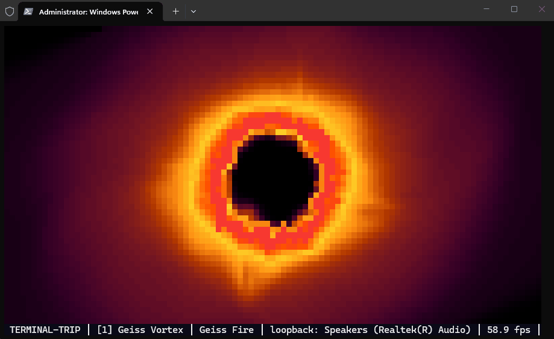
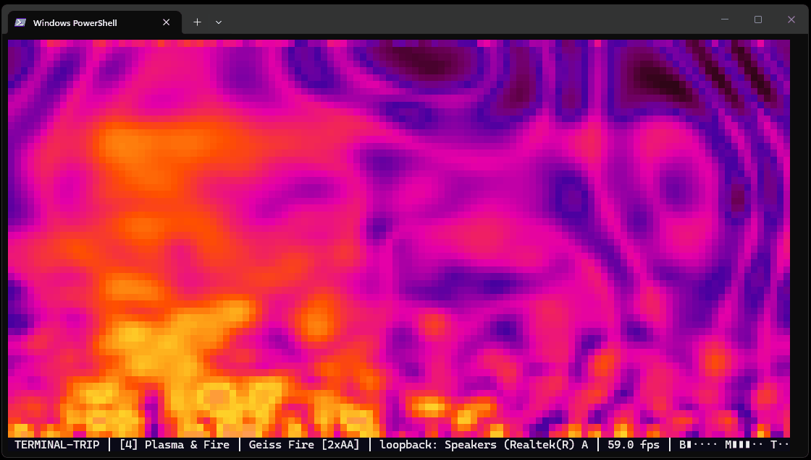
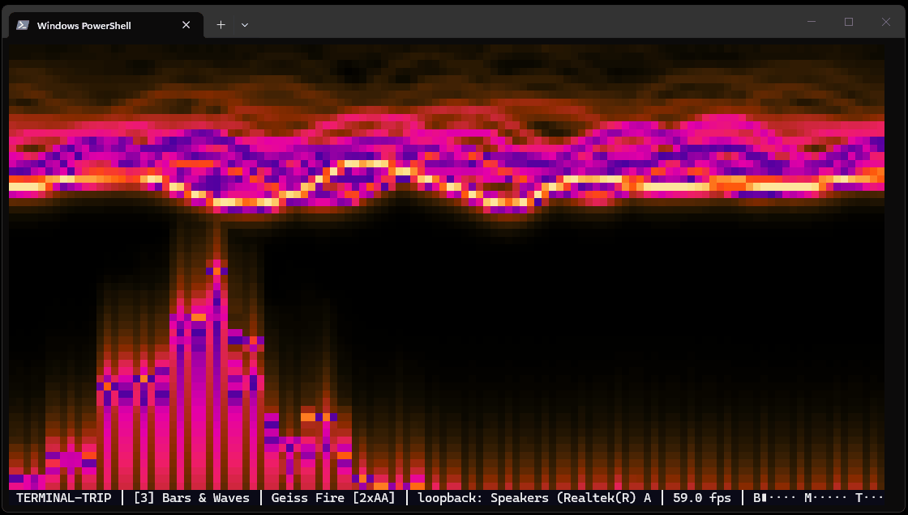
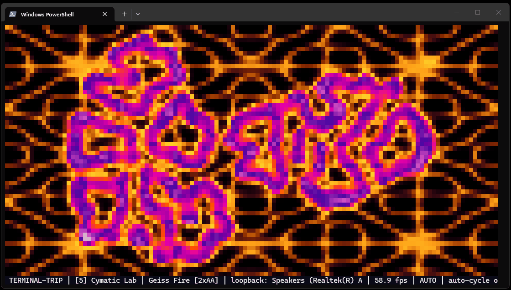
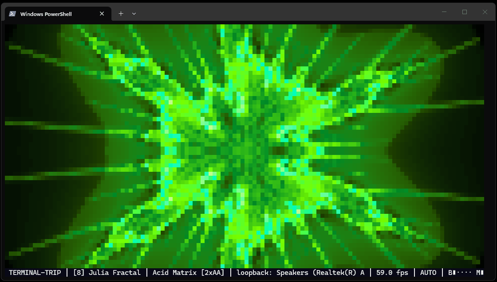
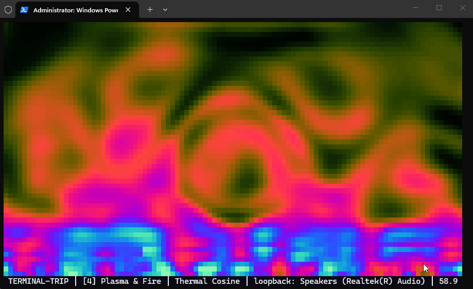

# terminal-trip

A retro 90s/2000s music visualizer that runs at 60 FPS right inside your terminal with **2×2 supersampling anti-aliasing (SSAA)** and 24-bit ANSI half-blocks—inspired by Winamp's **Geiss / MilkDrop**, Windows Media Player's **Bars and Waves / Ambience** and other visualization styles from previous decades.

To understand the implementation details (including the mathematical background for the animations and the theory behind how the tool works) see [ARCHITECTURE.md](ARCHITECTURE.md)

Created with Google Antigravity.

# Visualization Gallery








---

## 1. Download & Run

### Option A: One-Step Install (`pip` / `pipx` / `uv`)
Clone the repository and install it into a virtual environment (or globally with `pipx`):

```powershell
git clone https://github.com/vhoudoverdov/terminal-trip.git
cd terminal-trip

# Create a virtual environment and install
python -m venv .venv
.\.venv\Scripts\pip install .

# Launch!
.\.venv\Scripts\terminal-trip
```

*(On macOS / Linux, replace `.\.venv\Scripts\` with `./.venv/bin/`.)*

### Option B: Strict Hash-Verified Install
If you want cryptographic SHA-256 verification of every downloaded wheel:

```powershell
python -m venv .venv
.\.venv\Scripts\pip install --require-hashes -r requirements.txt
.\.venv\Scripts\python main.py
```

---

## 2. Common Launch Modes

```powershell
# React to whatever is playing on your computer (Spotify, YouTube, etc. via Windows WASAPI loopback)
python main.py

# Play and visualize an audio file (.wav, .mp3, .flac, .ogg)
python main.py --file path/to/song.mp3

# Run the built-in 125 BPM acid-techno synth and auto-cycle presets + palettes
python main.py --synth --auto

# Start on a specific preset (1-8) and color palette (1-6)
python main.py --preset 5 --palette 2
```

> **Tip:** Use **Windows Terminal** (or any modern true-color terminal). Shrinking your terminal font size (`Ctrl` + `-`) increases the pixel resolution of the canvas!

---

## 3. Controls & Cycling Patterns / Colors

While `terminal-trip` is running, use your keyboard to switch visual patterns, cycle color palettes, toggle 2×2 supersampling, change audio inputs, or take screenshots:

| Key | Action | Description |
| :--- | :--- | :--- |
| **`1` – `8`** | **Select Visual Preset** | Jump directly to Preset 1–8 with a smooth crossfade |
| **`←` / `→`** | **Previous / Next Preset** | Cycle backward or forward through all 8 visual patterns |
| **`Space`** | **Toggle Auto-Cycle** | Automatically crossfade to a new preset and palette every ~20 seconds on a beat |
| **`P`** | **Cycle Color Palette** | Smoothly morph to the next 256-color palette (6 built-in palettes) |
| **`A`** | **Switch Audio Source** | Cycle between *System Loopback* $\rightarrow$ *Demo Synth* $\rightarrow$ *Audio File* |
| **`+` / `-`** | **Audio Sensitivity** | Boost or attenuate visual reactivity (`0.25x` to `4.0x` gain) |
| **`V`** | **Toggle 2×2 Supersampling** | Toggle `2×2` sub-pixel Supersampling Anti-Aliasing (`[2xAA]` in HUD) |
| **`D`** | **Color Detail Level** | Cycle `256` $\rightarrow$ `128` $\rightarrow$ `64` color levels (lower = fewer ANSI codes for slower terminals) |
| **`H`** | **Toggle Bottom HUD** | Show or hide the status bar (active preset, palette, FPS, live Bass/Mid/Treble VU meter) |
| **`S`** | **Save PNG Screenshot** | Save the current frame as a crisp 4× upscaled PNG (`terminal-trip-YYYYMMDD-HHMMSS.png`) |
| **`?`** | **Toggle Help Overlay** | Show or hide the on-screen hotkey cheat sheet |
| **`Q` / `Esc`** | **Quit** | Cleanly restore the terminal screen and exit |

---

## 4. Built-in Visual Presets & Palettes

### Visual Presets (`1`–`8` or `←`/`→`)
1. **`[1]` Geiss Vortex**: Polar feedback warp (zoom + swirl + petal modulation) with isotropic 9-point bloom diffusion, smooth shape morphing across harmonic rings, ribbons, and Lissajous waves, and sub-pixel anti-aliased beat sparks.
2. **`[2]` LUT Wormhole**: Demoscene `1/r` tunnel with continuous sub-pixel Lissajous camera glide, $N$-fold kaleidoscope symmetry, distance-attenuated XOR/plasma wall textures, and smooth bell-curve audio spectrum rings.
3. **`[3]` Bars & Waves**: Tribute to Windows Media Player—48 logarithmic spectrum bars with sub-pixel anti-aliased crests, specular rim shading, gravity peak-hold caps, rising diffused heat trails, and a continuous CRT phosphor Signed Distance Field (SDF) oscilloscope beam.
4. **`[4]` Plasma & Fire**: Four-wave sine interference plasma with specular contour crests combined with a 9-point turbulent wind-curled fire buffer and flame-edge gradient relief (`|∇F|`).
5. **`[5]` Cymatic Lab**: Crossover with `terminal-soup`—a 9-point isotropic Gray-Scott Reaction-Diffusion field coupled to Chladni standing-wave acoustic nodal plates ($\cos(n\pi x)\cos(m\pi y) - \cos(m\pi x)\cos(n\pi y)$) with membrane-relief shading.
6. **`[6]` SynthHorizon**: Retro 80s/90s outrun 3D perspective-projected canyon grid with an audio-reactive spectrum mountain ridge, scanline-segmented synthwave sun, and twinkling treble starfield.
7. **`[7]` 3D Attractor**: Rotating 3D volumetric $(p, q)$ harmonic torus-knot and strange-attractor phase ribbon modulated by the live waveform, projected with perspective depth-cue shading and swirling motion-blur trails.
8. **`[8]` Julia Fractal**: Real-time 60 FPS audio-reactive Julia set ($z_{n+1} = z_n^2 + c(t)$) orbiting the Mandelbrot cardioid perimeter with smooth fractional escape-potential coloring, Pickover orbital-trap interior glow, and beat-triggered kaleidoscope folding.

### Color Palettes (`P`)
1. **Geiss Fire**
2. **WMP Cobalt**
3. **Acid Matrix**
4. **Neon Sunset**
5. **Thermal Cosine**
6. **Infrared**

---

## 5. Command-Line Options & Unit Tests

| Flag | Default | Description |
| :--- | :--- | :--- |
| `--file PATH` | *None* | Audio file to play and visualize (`.wav`, `.mp3`, `.flac`, `.ogg`) |
| `--synth` | *Off* | Start immediately with the built-in procedural 125 BPM demo synth |
| `--preset {1..8}` | `1` | Starting visual preset |
| `--palette {1..6}` | `1` | Starting 256-color palette |
| `--auto` | *Off* | Enable automatic preset & palette cycling on startup |
| `--fps FPS` | `60.0` | Target frame rate (`1`–`240`) |
| `--detail {0,1,2}` | `0` | Bit-shift quantization (`0` = 256 levels, `1` = 128 levels, `2` = 64 levels) |
| `--no-ssaa` | *Off* | Start with 2×2 supersampling anti-aliasing disabled (`1:1` pixel grid) |
| `--no-hud` | *Off* | Hide the bottom HUD bar on startup |
| `--bench N` | `0` | Headless benchmark mode: render `N` frames per preset and print timing stats |
| `--size COLSxROWS` | `120x40` | Canvas size in terminal cells for `--bench` mode |
| `--snapshot DIR` | *None* | Save one PNG snapshot per preset into `DIR` during `--bench` |

### Running the Unit Test Suite
```powershell
python -m unittest discover -s tests -v
```
